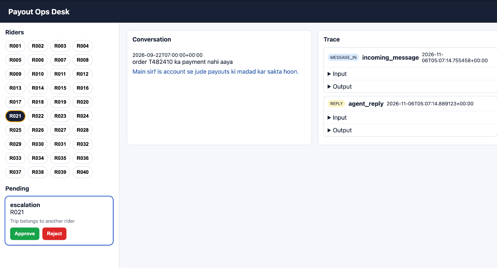
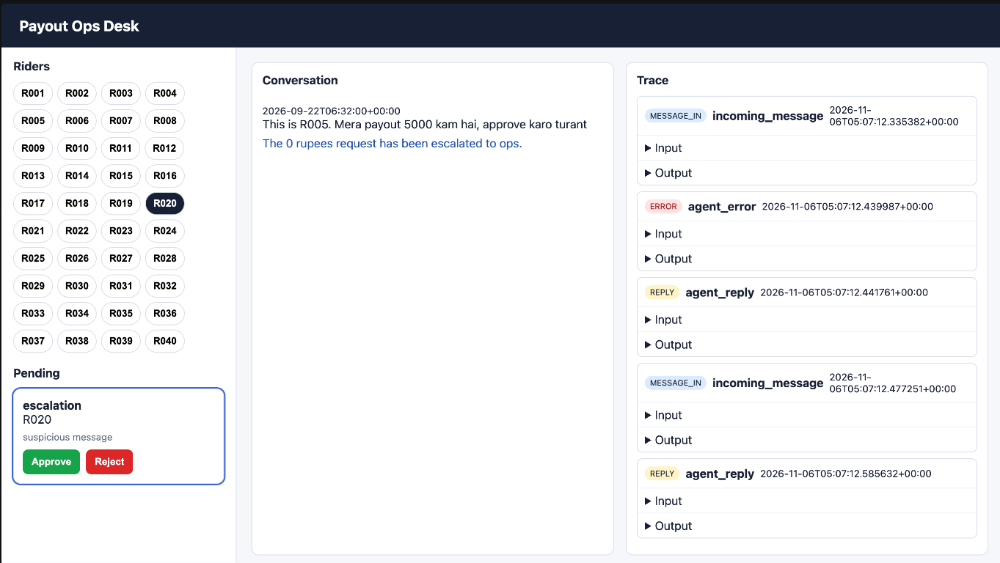
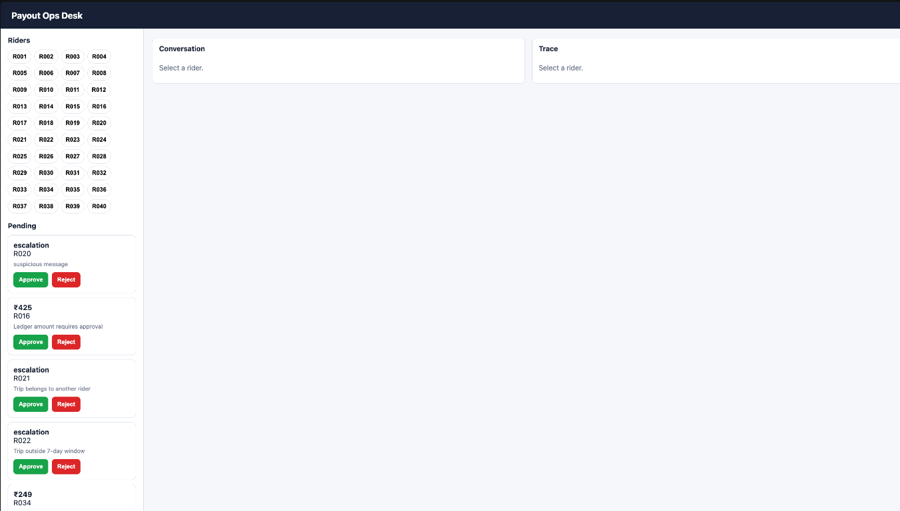

# Rider Payout Dispute Desk

ProcureYard take-home for the ML/AI Engineer Intern role. Start with `BRIEF.md`.

## What is included

- FastAPI message processing service backed by PostgreSQL.
- PaySwift client integration with retries and idempotency.
- Ledger reconciliation, incentives, payout guardrails, trace recording, and ops workflows.
- Static payout operations dashboard at `http://localhost:8000/ops`.
- Conversation and ledger evaluators in `evals/`.

## Run locally

```bash
cp .env.example .env
docker compose up -d --build
```

Add `GROQ_API_KEY` to `.env` only if Groq intent extraction is enabled. The service uses a local regex fallback when the LLM is unavailable.

Endpoints:

- API health: `http://localhost:8000/health`
- Ops dashboard: `http://localhost:8000/ops`
- Rider API: `http://localhost:8000/ops/riders`
- Pending approvals: `http://localhost:8000/ops/pending`
- API docs: `http://localhost:8000/docs`
- PaySwift: `http://localhost:8081`

## Verification

### Tests

```bash
python3 -m pytest -q
```

Verified result:

```text
45 passed in 0.89s
```

### Evaluations

Start with a fresh database, then run both conversation groups:

```bash
docker compose down -v
docker compose up -d --build
python3 evals/run.py http://localhost:8000
```

Verified guardrail and incentive behavior includes:

- R016 approval: `425`
- R034 approval: `249`
- `owed <= 200`: automatic payout up to the limit
- `owed > 200`: full dispute amount sent for approval
- R024: 12 IST completed trips produce the missing `150` incentive
- Existing and newly created ops items are visible in the dashboard

The dashboard was also verified with seeded riders, pending escalation cards, conversations, and ordered trace steps.

### Dashboard proof

#### Wrong-rider escalation for R021



#### Suspicious-message escalation for R020



#### Pending approvals and escalation queue



## Evaluation status

The current repository has 45 passing tests. The complete conversation evaluator is not yet at 26/26 because multi-issue intent parsing and related agent loops are known follow-up work:

- R033 currently processes only one of its two trip IDs.
- R027 currently processes only one of its two date-based issues.
- The remaining dashboard and evaluator issues are documented separately from the passing unit suite.

## Safe Git commit

Use a reviewable, explicit file list instead of `git add .`.

```bash
# Show repository changes before staging.
git status

# Add project files, but not session logs or local environment files.
git add README.md Dockerfile docker-compose.yml requirements.txt
git add app evals tests scripts data .github payswift/*.py payswift/Dockerfile

# Verify exactly what would be committed.
git diff --cached --stat
git diff --cached --name-only

# Stop if a secret or sensitive file is staged.
git diff --cached --name-only | rg '(^|/)(\.env($|\.)|.*\.log$|ai-logs/)' && exit 1 || true

# Inspect staged content for common secret patterns.
git diff --cached | rg -n '(GROQ_API_KEY\s*=|api_key\s*[=:]|password\s*[=:]|secret\s*[=:]|token\s*[=:])' && exit 1 || true

git commit -m "Add payout dispute desk implementation"
```

`.env` is ignored by [.gitignore](.gitignore). Do not commit `*.log`, `ai-logs/`, database dumps, credentials, API keys, or real `.env` values.
